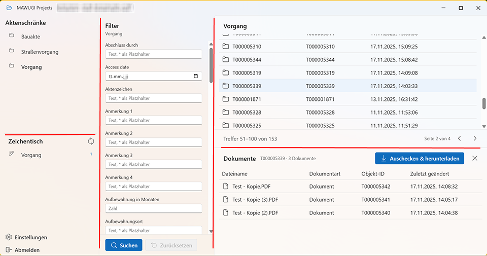
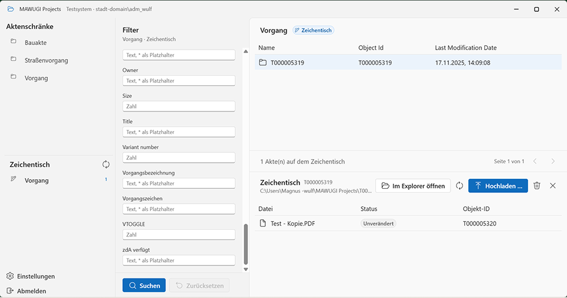
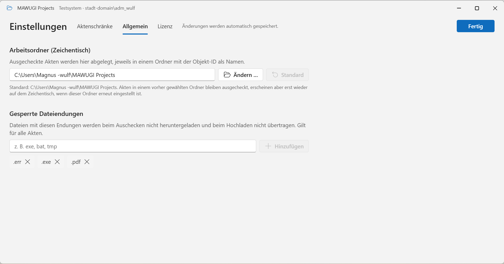

# MAWUGI Projects - Nutzerhandbuch
Herzlich willkommen im Benutzerhandbuch, ich hoffe Sie finden die Ausführungen hilfreich.
## Benutzeroberfläche
### Übersicht
Die folgende Übersicht zeigt Ihnen die wesentlichen Bereiche der Oberfläche.

1. **Aktenschränke**: hier finden Sie alle Aktenarten, auf die Sie berechtigt sind. Sofern gewisse Aktenarten für Sie in MAWUGI Projects nicht relevant sind, können Sie diese ausblenden.

2. **Zeichentisch**: hier finden Sie alle ausgecheckten Akten / Projekte.

3. **Filter**: hier können Sie die Aktenschränke und Zeichentische durchsuchen. Die Auswahl der filterbaren Spalten und deren Anordnung können Sie je Aktenart konfigurieren.

4. **Ergebnisliste**: in der Ergebnisliste finden Sie alle gefundenen Akten. Bitte beachten Sie die Paginierung. Die Auswahl und Anordnung der Spalten können Sie unabhängig von der Filterreihenfolge anpassen.

5. **Dokumente**: in diesem Bereich sehen Sie die Dokumente einer Akte und können diese mit einem Klick auf "Auschecken & herunterladen" für die lokale Bearbeitung bereitstellen.

6. **Einstellungen**: hier können Sie die bereits genannten Einstellungen tätigen.

### Bereichsgrenzen
Die rot markierten Bereichsgrenzen können mit gedrückter linker Maustaste verschoben werden.

## Zeichentisch
Auf dem Zeichentisch sehen Sie nur Aktenschränke, aus denen Sie bereits Akten ausgecheckt haben.

## Einstellungen

### Aktenschränke

### Weitere Einstellungen
